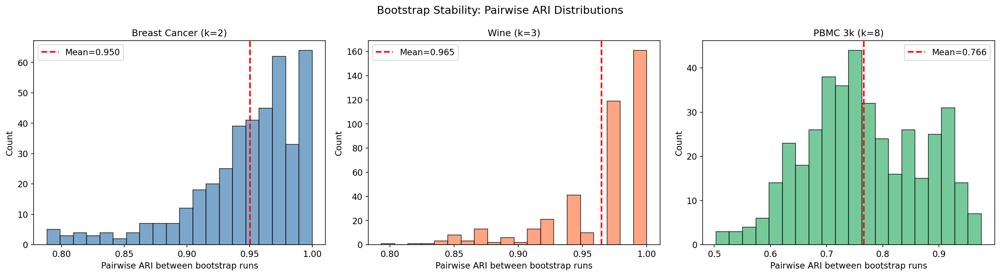
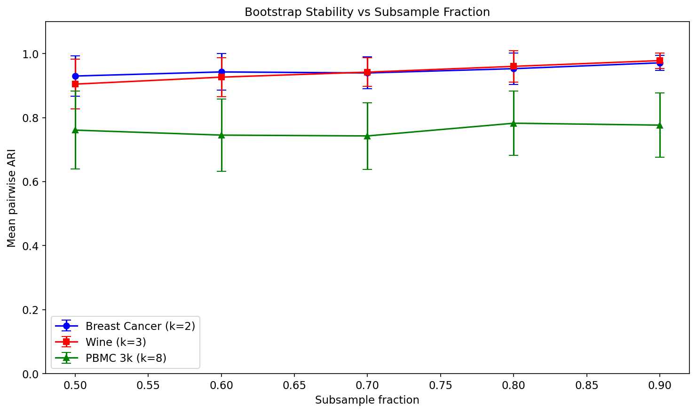
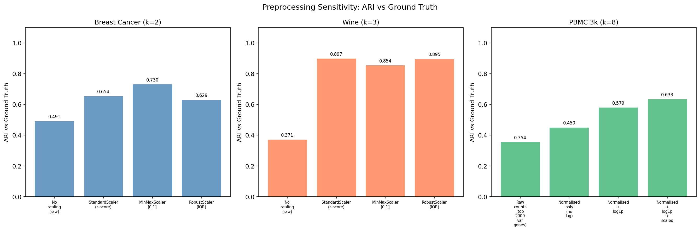
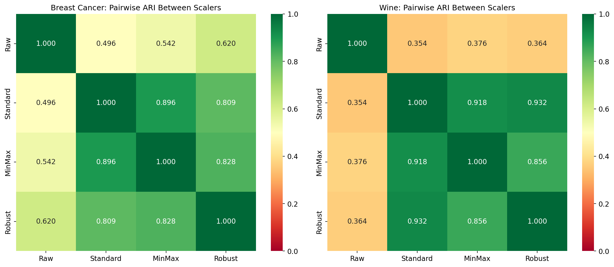
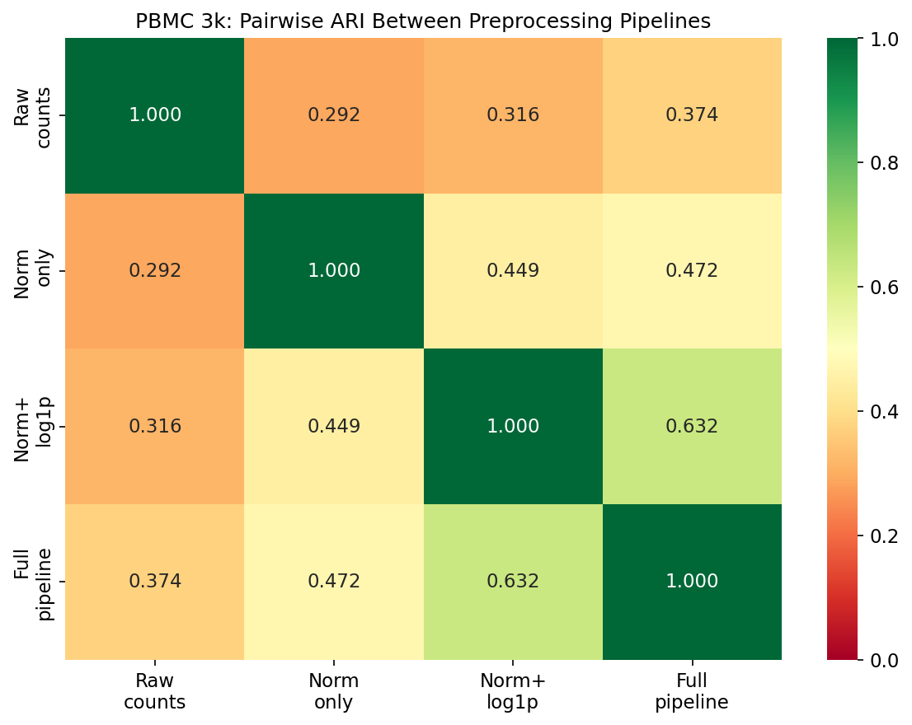
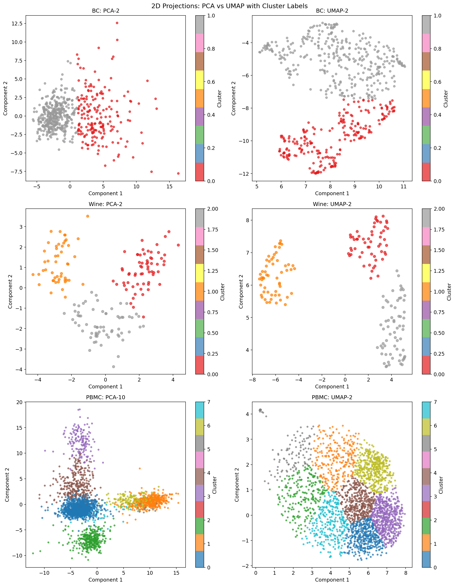
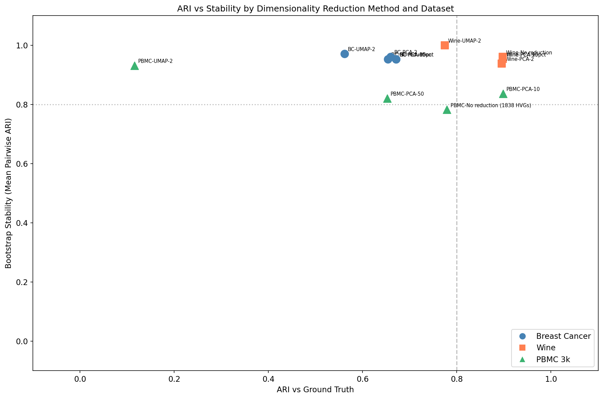
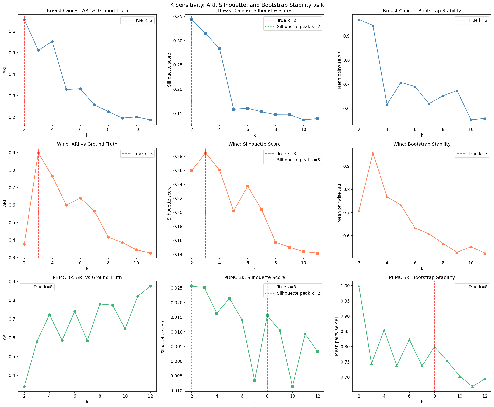
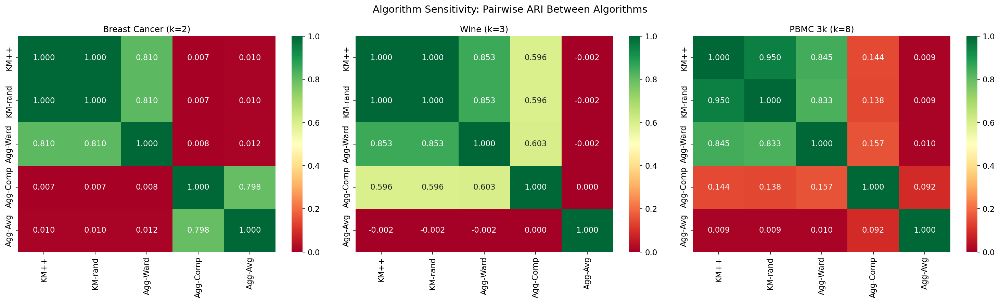

# When Can Clustering Be Trusted?
## A Stability Analysis of Unsupervised Learning Under Perturbation

> One executed notebook, `clustering_stability_analysis_executed.ipynb`, runs five perturbation experiments (bootstrap stability, preprocessing, dimensionality reduction, k and algorithm) on two labelled sklearn benchmarks and the PBMC 3k single-cell RNA-seq dataset, and writes its results to `results.json` and `results_summary.csv`.
>
> It asks when clustering reflects real structure in data, and what happens to stability and agreement when the assumptions behind clustering are violated.

---

## Table of Contents
- [Motivation](#motivation)
- [Datasets](#datasets)
- [Experiment 1: Bootstrap Stability](#experiment-1-bootstrap-stability)
- [Experiment 2: Preprocessing Sensitivity](#experiment-2-preprocessing-sensitivity)
- [Experiment 3: Dimensionality Reduction](#experiment-3-dimensionality-reduction)
- [Experiment 4: K Sensitivity](#experiment-4-k-sensitivity)
- [Experiment 5: Algorithm Sensitivity](#experiment-5-algorithm-sensitivity)
- [Summary of Findings](#summary-of-findings)
- [Scope of Inference](#scope-of-inference)
- [Next Experiments](#next-experiments)
- [FAQ](#faq)
- [Reproducibility](#reproducibility)

---

## Motivation

Unsupervised clustering is widely used to discover structure in data, particularly in high-dimensional domains like genomics, immunology, and single-cell analysis. Clustering conclusions rest on assumptions that practitioners rarely make explicit:

1. That the chosen distance metric captures meaningful similarity
2. That the number of clusters k reflects real structure, not algorithmic artefact
3. That preprocessing choices are neutral
4. That results are stable, meaning they would re-emerge with slightly different data or a different algorithm

This notebook tests these assumptions using controlled perturbation experiments. The core evaluation metric is the adjusted rand index (ARI): 0 means random agreement, 1 means perfect agreement, negative means worse than chance.

The PBMC 3k dataset is included specifically because it represents how clustering is actually used in biology: high-dimensional data, no independent ground truth, preprocessing choices that are biologically motivated rather than statistically neutral. The sklearn datasets provide a controlled baseline; PBMC shows what happens under realistic conditions.

---

## Datasets

| Dataset | Samples | Features | True Classes | Ground Truth Type | Source |
|---|---|---|---|---|---|
| Breast Cancer Wisconsin | 569 | 30 | 2 (malignant/benign) | Independent pathology labels | `sklearn.datasets` |
| Wine Recognition | 178 | 13 | 3 (cultivar types) | Independent chemical analysis | `sklearn.datasets` |
| PBMC 3k | 2638 | 1838 (HVGs) | 8 (cell types) | Louvain clustering + manual annotation | `scanpy.datasets` |

**On the study design:** The sklearn datasets serve as a positive control. They establish what stable, trustworthy clustering looks like when the algorithm's assumptions are approximately satisfied. The sklearn results are not findings in themselves; they are the baseline against which PBMC can be meaningfully compared. PBMC is where the assumptions break and the results become interpretively interesting.

**On the PBMC ground truth:** The cell type labels for PBMC 3k were produced by running Louvain clustering on the data and manually annotating each resulting cluster. ARI against these labels therefore measures how closely k-means agrees with Louvain, the reference behind the labels, and every PBMC result in this notebook is read that way.

---

## Experiment 1: Bootstrap Stability

**Question: Would the same clusters emerge with slightly different data?**

Method: repeatedly subsample 80% of the data, cluster each subsample, then measure pairwise ARI between all pairs of clustering runs on their shared samples.



| Dataset | Mean Pairwise ARI | Std |
|---|---|---|
| Breast Cancer (k=2) | 0.95 | 0.05 |
| Wine (k=3) | 0.96 | 0.04 |
| PBMC 3k (k=8) | 0.77 | 0.10 |

The contrast is clear. The sklearn datasets are highly stable; PBMC at k=8 is noticeably less stable, with a standard deviation twice as large. This is not surprising: k=8 clustering of a continuous high-dimensional manifold produces more variable partition boundaries than k=2 clustering of well-separated classes.



PBMC stability degrades more steeply as subsample fraction decreases, which is consistent with a dataset where cluster boundaries are less crisp.

**Reading the PBMC figure:** the stability of 0.77 is consistency with the Louvain-derived reference labels (see [Scope of Inference](#scope-of-inference), item 2).

---

## Experiment 2: Preprocessing Sensitivity

**Question: How much do preprocessing choices change what structure is found?**

For the sklearn datasets, four standard scalers were compared. For PBMC, four biologically motivated preprocessing pipelines were compared: raw counts (top 2000 variable genes by variance), normalisation only (library size normalisation, no log transform), normalisation plus log1p, and the full standard pipeline (normalisation, log1p, scaling). These choices are not arbitrary: they correspond to distinct assumptions about what variation is signal versus noise.



| Dataset | Best Preprocessing ARI | Worst Preprocessing ARI | Range |
|---|---|---|---|
| Breast Cancer | 0.73 | 0.49 | 0.24 |
| Wine | 0.90 | 0.37 | 0.53 |
| PBMC 3k | 0.63 | 0.35 | 0.28 |




The minimum pairwise ARI between any two PBMC preprocessing pipelines is 0.29. This means raw counts and the full standard pipeline find almost entirely different structures in the same data. For Wine the equivalent figure is 0.35. In both cases, the choice of preprocessing method alone is sufficient to change the clustering solution substantially: two methods applied to the same data can agree only weakly, at a level that would not support confident conclusions about structure.

For PBMC specifically: note that the best preprocessing ARI (0.63) is the full standard pipeline (the scanpy tutorial default), the same pipeline that produced the Louvain reference labels, so this comparison measures how far ARI moves away from the reference pipeline ([Scope of Inference](#scope-of-inference), item 8).

---

## Experiment 3: Dimensionality Reduction

**Question: Does reducing dimensions before clustering help or hurt?**

For sklearn datasets: no reduction, PCA-2, PCA-10, PCA retaining 95% variance, and UMAP-2. For PBMC: no reduction (full 1838 HVGs), PCA-10, PCA-50, and UMAP-2. PCA-50 followed by UMAP is the current consensus workflow for single-cell data (Wolf et al., 2018; Luecken and Theis, 2019) and serves as a reference point.





| Dataset | Best ARI method | Best ARI | Best Stability method | Best Stability |
|---|---|---|---|---|
| Breast Cancer | PCA-10 | 0.67 | UMAP-2 | 0.97 |
| Wine | No reduction | 0.90 | UMAP-2 | 1.00 |
| PBMC 3k | PCA-10 | 0.90 | UMAP-2 | 0.93 |

The ARI vs stability scatter (figure 10) is the most informative plot in the notebook. It separates two failure modes: methods that are stable but inaccurate (top-left), and methods that are accurate but unstable (bottom-right).

The most striking PBMC result: UMAP-2 achieves the highest stability (0.93) but an ARI of only 0.12 against the Louvain reference labels. This does not mean UMAP is wrong. It means UMAP finds a different partition than Louvain, and because the reference labels are themselves Louvain-derived, UMAP's partition scores poorly regardless of whether it reflects the underlying biology better or worse. This is the circularity problem made concrete.

PCA-10 achieves the highest PBMC ARI (0.90), which is not what the rationale for including PCA-50 would predict. The reference pipeline uses PCA-50 before Louvain clustering, so PCA-50 should in principle be the representation most compatible with the reference labels. That PCA-10 outperforms PCA-50 (0.65) suggests k-means benefits from a more aggressive dimensionality reduction: PCA-10 retains only the dominant axes of variation and discards components that add noise relative to the k-means objective. This finding is acknowledged as unanticipated in the notebook's methodological decisions section.

The PBMC full-dimension baseline (1838 HVGs) has a near-zero silhouette score (0.003), meaning k-means in full gene expression space produces clusters with no clear Euclidean separation. This is a common finding in single-cell data (Luecken and Theis, 2019) and is part of why dimensionality reduction before clustering is standard practice.

---

## Experiment 4: K Sensitivity

**Question: How sensitive are conclusions to the choice of k?**



| Dataset | True k | Silhouette peak k | ARI peak k |
|---|---|---|---|
| Breast Cancer | 2 | 2 | 2 |
| Wine | 3 | 3 | 3 |
| PBMC 3k | 8 | 2 | 12 |

For the sklearn datasets, silhouette correctly identifies the true k. For PBMC, the disconnect is striking: silhouette recommends k=2 (binary split of the data) while the Louvain reference has 8 cell types and ARI continues rising through k=12 with no clear peak. This is not a contradiction. It reflects two different things being measured: silhouette scores the compactness and separation of the k-means partition by Euclidean distance, while ARI measures agreement with a Louvain partition that was not produced by k-means. Neither is telling you the "true" number of cell types.

Bootstrap stability generally decreases as k increases beyond the true value. For PBMC, stability is more variable across the k range, consistent with a dataset that does not have sharply defined compact clusters in Euclidean space.

---

## Experiment 5: Algorithm Sensitivity

**Question: Do k-means and hierarchical clustering find the same structure?**



For the sklearn datasets, k-means++ and Ward linkage show high pairwise ARI. For PBMC, agreement between algorithm families is lower, which is consistent with cell type boundaries that are not geometrically convex. Ward linkage assumes compact spherical clusters; this is not how cell populations are distributed in high-dimensional gene expression space.

Algorithm divergence for PBMC is a finding in itself: it suggests that the discovered structure depends on which algorithm you choose, not just which preprocessing pipeline.

---

## Summary of Findings

| What Was Found | Confidence | Why |
|---|---|---|
| Preprocessing choice shifts ARI by 0.24 (BC) to 0.53 (Wine) to 0.28 (PBMC) | High | Measured directly across all three datasets |
| StandardScaler outperforms no scaling for BC and Wine | High | Consistent across both sklearn datasets |
| Full standard pipeline outperforms raw counts for PBMC | Moderate | ARI against Louvain labels produced with the same pipeline (Scope of Inference, item 7) |
| Bootstrap stability is substantially lower for PBMC (0.77) than for sklearn datasets (0.95-0.96) | High | Consistent finding, expected given higher k and less crisp boundaries |
| Silhouette correctly identifies true k for BC and Wine | Moderate | Two clean benchmark datasets with independent labels |
| PBMC k-means in full gene expression space has near-zero silhouette (0.003) | High | Direct measurement; consistent with known behaviour of Euclidean distance in high dimensions |
| Algorithm agreement is lower for PBMC than for sklearn datasets | Moderate | Measured on PBMC at k=8 |

---

## Scope of Inference

Each result is defined by what it measures. This is the scope each conclusion carries.

### 1. Benchmarks with independent labels
Breast Cancer and Wine are clean, balanced, well-studied benchmarks with independent labels; their numbers describe that regime.

### 2. The PBMC reference labels
The PBMC 3k cell type labels were produced by Louvain clustering with manual annotation, so ARI against them measures agreement with that one clustering solution: a high ARI means k-means agrees with Louvain. Every PBMC result in this notebook is read that way.

### 3. Bootstrap stability is algorithmic stability
Bootstrap stability measures whether a partition re-emerges under resampling. It is a necessary condition for trustworthy clustering and is read together with ARI and silhouette.

### 4. K-means geometry
K-means assumes spherical, equal-sized clusters. The sklearn datasets approximately satisfy this; PBMC does not, since its cell populations range from 15 cells (Megakaryocytes) to 1144 (CD4 T cells) and are not compact spheres in gene expression space.

### 5. UMAP layouts
UMAP layouts can differ across hardware, operating systems and library versions even with a fixed random seed, so the UMAP results are read as layouts rather than exact coordinates.

### 6. Subsample fraction
The bootstrap stability estimate depends on the subsample fraction; this analysis uses the conventional 0.8.

### 7. The PBMC preprocessing comparison
The four PBMC pipelines include the full standard pipeline (normalise, log1p, scale), which is the pipeline that produced the Louvain reference labels. The experiment therefore measures how far ARI moves when a pipeline departs from the one behind the reference labels.

### 8. PBMC 3k as the biological benchmark
PBMC 3k is the standard single-cell benchmark across methods papers and tutorials because it is well characterised and relatively clean. Noisier datasets, batch effects and more ambiguous cell type boundaries are the next test.

---

## Next Experiments

1. **Multiple real biological datasets with independent validation.** Cell type labels validated by flow cytometry or independent sequencing modalities, rather than by a second clustering algorithm, give the PBMC evaluation a reference independent of clustering.

2. **Systematic noise injection.** Inject controlled amounts of Gaussian noise, artificial batch effects, or dropout (zero-inflation) into the PBMC data and measure how stability and ARI degrade as a function of noise level. This produces interpretable thresholds for when clustering conclusions can be trusted.

3. **Include density-based methods.** DBSCAN and HDBSCAN make no assumptions about cluster shape or number and are used in some single-cell workflows. Including them tests whether the k-means and hierarchical agreement seen here holds for fundamentally different algorithm families.

4. **Statistical significance with corrections.** With 5 algorithms, 4 preprocessing pipelines, and 5 dimensionality reduction methods across 3 datasets, uncorrected pairwise comparisons produce spurious differences, so Bonferroni or FDR correction comes before ranking methods.

---

## FAQ

**Why use k-means on single-cell data when it assumes spherical, equal-sized clusters?**

Deliberately. K-means is a poor fit for PBMC because cell populations are not geometrically convex and differ enormously in size (Megakaryocytes: 15 cells; CD4 T cells: 1144 cells). That mismatch is the point. The sklearn datasets serve as a positive control where the assumptions are approximately satisfied. Comparing the two cases shows concretely what assumption violation costs in terms of stability and accuracy.

**The PBMC ground truth is Louvain-derived. Does that make every PBMC result meaningless?**

Not meaningless, but it changes what is being measured. ARI against Louvain labels measures algorithmic agreement, not biological truth. The useful findings do not depend on the labels being correct: the near-zero silhouette in full gene expression space, the degradation in bootstrap stability relative to the sklearn datasets, and the low minimum pairwise ARI between preprocessing pipelines (0.29) are all measured independently of the reference labels. Where a result depends on the labels, it is read as agreement with Louvain.

**UMAP-2 has ARI=0.12 for PBMC. Does that mean UMAP finds the wrong clusters?**

Not necessarily. UMAP partitions the space differently than Louvain, and because the reference labels are Louvain-derived, UMAP's partition scores poorly against them regardless of whether it is biologically more or less accurate. The low ARI reflects disagreement between two algorithms, not a ground truth verdict. UMAP-2 simultaneously achieves the highest bootstrap stability for PBMC (0.93), which means it is finding a consistent structure, just not the same one Louvain finds.

**Silhouette recommends k=2 for PBMC but you cluster at k=8. Why not use k=2?**

Silhouette measures Euclidean compactness and separation. It correctly identifies that PBMC has one dominant axis of variation in PCA space (broadly, myeloid versus lymphoid lineages) and rewards the partition that captures it cleanly. The 8 cell types in the Louvain reference reflect finer biological distinctions that are not Euclidean-compact. The experiment uses k=8 to measure agreement with the reference labels, not because silhouette endorses that choice. The disconnect between silhouette peak (k=2) and ARI peak (k=12, still rising) is itself a finding: it illustrates that the two criteria are measuring different things.

**PCA-10 outperforms PCA-50 for PBMC ARI. Shouldn't PCA-50 be the most compatible representation with the Louvain reference?**

Yes, and that is why the result is noted as unanticipated. The reference pipeline uses PCA-50 before Louvain clustering, so PCA-50 should in principle yield the highest ARI against those labels. That PCA-10 outperforms it (0.90 vs 0.65) suggests k-means benefits from more aggressive dimensionality reduction: retaining only the dominant axes of variation and discarding components 11 to 50, which may add noise relative to the Euclidean k-means objective. This is discussed in the methodological decisions section of the notebook.

**Is a bootstrap stability of 0.77 for PBMC good or bad?**

It is lower than the sklearn datasets (0.95 to 0.96) and has higher variance (standard deviation 0.10 vs 0.04 to 0.05), which is consistent with less crisp cluster boundaries. There is no universal threshold for what counts as trustworthy stability: Ben-Hur et al. (2002) use it as a relative criterion for selecting k rather than an absolute pass/fail criterion. A principled threshold needs datasets with known ground truth across a range of difficulty levels, which is what the noise injection experiment in [Next Experiments](#next-experiments) is designed to provide.

---

## Reproducibility

| | |
|---|---|
| Platform | Windows 11 Home Single Language |
| Python | 3.12.8 |
| scikit-learn | 1.8.0 |
| UMAP | 0.5.11 |
| scanpy | 1.12 |
| NumPy | 2.4.3 |
| SciPy | 1.17.1 |
| pandas | 2.3.3 |
| Random seed | 42 (documented in notebook) |

To reproduce:
```bash
git clone https://github.com/rajo69/clustering-stability-analysis.git
uv venv .venv
source .venv/Scripts/activate   # Windows: .venv\Scripts\activate
uv pip install -r requirements.txt
uv run jupyter notebook clustering_stability_analysis_executed.ipynb
```

Note: PBMC 3k data is downloaded automatically by scanpy on first run (~30 MB). Every experiment uses random seed 42.

---

## References

Ben-Hur, A., Elisseeff, A., and Guyon, I. (2002). A stability based method for discovering structure in clustered data. *Pacific Symposium on Biocomputing*, 7, 6-17.

Luecken, M. D. and Theis, F. J. (2019). Current best practices in single-cell RNA-seq analysis: a tutorial. *Molecular Systems Biology*, 15(6), e8746.

McInnes, L., Healy, J., and Melville, J. (2018). UMAP: Uniform manifold approximation and projection for dimension reduction. *arXiv:1802.03426*.

Stuart, T., Butler, A., Hoffman, P., Hafemeister, C., Papalexi, E., Mauck, W. M., et al. (2019). Comprehensive integration of single-cell data. *Cell*, 177(7), 1888-1902.

Wolf, F. A., Angerer, P., and Theis, F. J. (2018). SCANPY: large-scale single-cell gene expression data analysis. *Genome Biology*, 19(1), 15.
